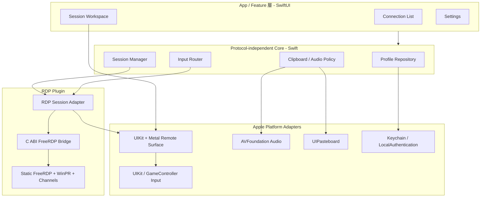
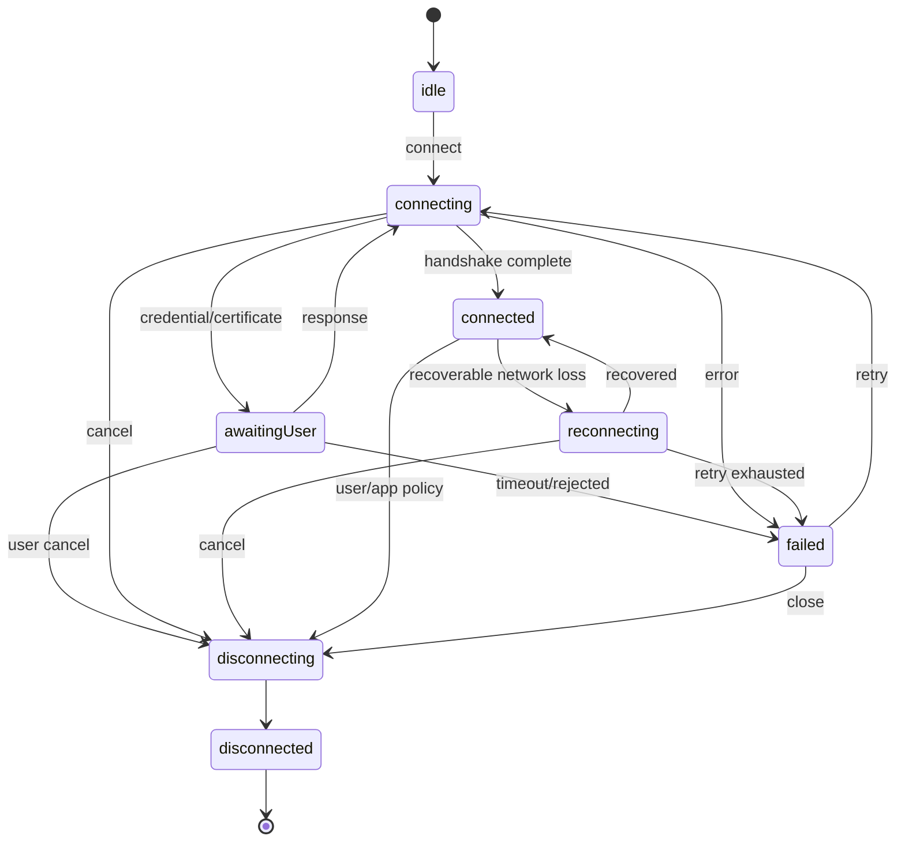

# アーキテクチャ設計

## 1. 設計方針

- UI、セッション管理、入力、プロトコル実装を分離し、FreeRDP の C 型を機能/UI 層へ漏らさない。
- 1 セッションのブロッキング I/O、デコード、回復可能な protocol error を専用実行コンテキストへ閉じ込める。
- 高頻度のフレームとポインター入力はコピー回数を抑え、状態・エラーは Swift Concurrency で安全に伝える。
- iOS のライフサイクル制約を前提にし、バックグラウンド常駐を正常系として設計しない。
- 最初から RDP/SSH の巨大な共通化を行わない。共通なのはプロファイル、ライフサイクル、一覧/切替 UI と正規化入力までとする。

## 2. 全体構成



依存方向は上から下のみとする。FreeRDP コールバックから UI を直接操作しない。状態/challenge/error の control plane は session actor と SessionManager を経由し、frame/audio/input の高頻度 data plane は専用 store/queue を経由して SessionManager を通さない。

## 3. ターゲット/モジュール案

初期は一つの Xcode workspace 内に、次の Swift Package または framework target を置く。小規模な段階では target 数を統合してもよいが、依存境界は維持する。

| モジュール | 責務 | 依存可能先 |
|---|---|---|
| `mRemoteApp` | App/Scene、DI、ルート遷移 | Feature群、SessionCore |
| `ConnectionFeature` | 接続先一覧、編集、証明書/資格情報 UI | SessionCore、Persistence |
| `SessionFeature` | 全画面ワークスペース、切替、フローティングメニュー | SessionCore、RemoteSurface |
| `SettingsFeature` | グローバル設定、資格情報/信頼管理 | SessionCore、Persistence |
| `SessionCore` | プロファイル、セッション状態、SessionManager、プロトコル非依存 interface | Foundation のみを基本 |
| `InputCore` | HID/ポインターの正規化、押下状態、focus ルーティング（protocol mapping は持たない） | SessionCore |
| `RemoteSurface` | `UIView`、Metal 描画、座標変換、入力キャプチャ | InputCore、Metal/UIKit |
| `RDPProtocol` | RDP 設定、RemoteSession 実装、HID-to-scan-code、チャネル連携 | SessionCore、FreeRDPBridge |
| `FreeRDPBridge` | FreeRDP C API、メモリ所有権、callback の C ABI 化 | FreeRDP バイナリのみ |
| `AppleAdapters` | Keychain、UIPasteboard、AVFoundation、OSLog | SessionCore |
| `Persistence` | プロファイル/設定の schema と migration | SessionCore |

リポジトリ上の配置は次のとおり。単一プロダクトなので、platform ではなく役割で切る。

| モジュール | 配置 |
|---|---|
| `mRemoteApp`、各 Feature | `App/` と `mRemote.xcodeproj`（Phase 1 の UI 着手時に作成） |
| `SessionCore`、`Persistence`、`AppleAdapters` | `Packages/mRemoteKit/` |
| `InputCore`、`RDPProtocol` | Phase 3 で `Packages/mRemoteKit/` へ追加。現在は `tools/Phase0Harness/` 内にある |
| `RemoteSurface` | Phase 2 で追加。現在は harness の `RemoteSurfaceView` |
| `FreeRDPBridge` | `bridge/`（C）と `artifacts/` の生成 XCFramework |

将来は `SSHProtocol` と `TerminalSurface` を追加する。`ConnectionFeature` は protocol discriminator に応じた設定セクションを差し込み、`SessionFeature` は session が提供する surface kind (`desktop`/`terminal`) を表示する。

## 4. コア interface

以下は責務を示す概念 API であり、名称は実装時に Swift API Design Guidelines に合わせる。

```swift
public protocol RemoteSession: Actor {
    nonisolated var id: SessionID { get }
    func controlEvents() -> AsyncStream<SessionControlEvent>
    func connect() async throws
    func disconnect(reason: DisconnectReason) async
    func respond(to challengeID: ChallengeID,
                 with response: ChallengeResponse) async throws
}

public protocol DesktopSession: RemoteSession {
    nonisolated var frameStore: LatestDesktopFrameStore { get }
    nonisolated var inputSink: DesktopInputSink { get }
    func setVisibility(_ visibility: SessionVisibility) async
}

public protocol ClipboardCapableSession: RemoteSession { /* offer/request */ }
public protocol AudioCapableSession: RemoteSession { /* state/control */ }

public enum SessionControlEvent: Sendable {
    case stateChanged(SessionState)
    case userActionRequired(SessionChallenge)
    case error(RemoteSessionError)
}
```

共通 interface は lifecycle/state/challenge までとし、desktop frame、scan code/pointer、audio、clipboard は capability interface に分ける。将来の SSH terminal が RDP 固有型を実装する必要はない。Apple の raw HID event は InputCore で正規化するが、HID-to-RDP scan code mapper は `RDPProtocol` に置く。

concrete RDP session は actor とし、native pointer 自体は専用 worker だけが触る。challenge は session generation と一意な ID に束縛し、一度だけ回答可能にする。`disconnect` は native event loop と challenge wait の双方を wake し、actor executor や main thread を block しない。

control notification は順序を保つ有限 buffer とし、状態と未回答 challenge は session actor/SessionManager に authoritative に保持していつでも再読込可能にする。buffer overflow 時も challenge/error 自体を失わず、再読込 signal をまとめる。frame は `AsyncStream` に載せず、`LatestDesktopFrameStore + coalesced signal` とする。metrics も latest-value/counter とし、challenge/error と同じ buffering policy に置かない。

`DesktopInputSink` は capture 順の sequence を同期的に採番して bounded queue へ投入し、一つの drain が FreeRDP worker 上で送る。key/button transition は lossless、pointer move は最新へ coalesce、wheel は delta を累積する。UIKit callback ごとに順序未保証の `Task` を生成しない。

有限 queue では、受理した key/button down ごとに対応する up の slot を先に予約する。high-water 到達時は pointer move を coalesce/破棄し、wheel を一つの累積値へまとめ、それでも足りなければ新しい down の受理前に input gate を閉じる。すでに受理した up を落とさない。transition を収容不能または drain が stall した場合は session を input-failed/recovery へ遷移させ、無制限 buffer に逃がさない。

`ConnectionProfile` は共通メタデータと versioned protocol payload に分ける。

```swift
struct ConnectionProfile: Identifiable, Codable, Sendable {
    var id: UUID
    var displayName: String
    var protocolConfiguration: ProtocolConfiguration
    var credentialReference: CredentialReference?
    var overrides: ProfileOverrides
}

enum ProtocolConfiguration: Codable, Sendable {
    case rdp(RDPConfiguration)
    // case ssh(SSHConfiguration)
}
```

FreeRDP の設定構造体やポインターは `RDPProtocol` より上に公開しない。

## 5. FreeRDP 統合

### 5.1 採用方法

FreeRDP/WinPR と必要な channel plugin を固定タグまたは commit からビルドし、次の slice を持つ静的 `XCFramework` にする。

- iPhone/iPad device: `arm64`
- Simulator: `arm64`、開発環境で必要なら `x86_64`

iOS では任意コード/プラグインの後日ロードを行わず、全 add-in をバイナリへ静的リンク/ビルド時登録する。これは RDP wire 上の channel 種別とは別概念である。wire 上では `cliprdr`/`rdpsnd` は Static Virtual Channel、`drdynvc` は Dynamic Virtual Channel を運ぶ SVC、`disp`/`rdpgfx` はその上の DVC として扱う。FreeRDP の共通 client loader は `rdpsnd` 有効時に `rdpdr` 登録も要求するため、core `rdpdr` add-in は静的リンクするが、drive/printer/smart-card/serial/parallel の device service backend は無効化する。不要な server、X11、Wayland、PulseAudio、カメラ/デバイス redirection backend は除く。

FreeRDP は Apache-2.0 系だが、リンクする TLS/codec/音声依存を含む Software Bill of Materials と notice を生成する。FFmpeg/OpenH264 等を追加する場合は、バイナリ配布条件と App Store 適合性を個別確認してから有効化する。

### 5.2 Bridge 境界

Swift から FreeRDP の公開構造体を直接操作せず、opaque handle を受け渡す小さな C API を置く。

```c
typedef struct mr_rdp_session mr_rdp_session;
typedef struct mr_rdp_callbacks mr_rdp_callbacks;

typedef uint8_t mr_key_action;
enum { MR_KEY_DOWN = 0, MR_KEY_UP = 1 };
typedef struct {
    uint16_t code;
    uint8_t extended;
    uint8_t extended1;
    mr_key_action action;
} mr_rdp_key_event;

mr_rdp_session *mr_rdp_session_create(
    const mr_rdp_config *config,
    const mr_rdp_callbacks *callbacks,
    void *context);
int mr_rdp_session_run(mr_rdp_session *session);
void mr_rdp_session_request_stop(mr_rdp_session *session);
int mr_rdp_session_send_key(mr_rdp_session *session, const mr_rdp_key_event *event);
int mr_rdp_session_send_pointer(mr_rdp_session *session, const mr_pointer_event *event);
void mr_rdp_session_destroy(mr_rdp_session *session);
```

Bridge の契約:

- create/destroy、callback のスレッド、バッファ所有者と有効期間を header に明記する。
- `mr_rdp_key_event` は raw Set 1 code、down/up、`EXTENDED`/`EXTENDED1` を明示し、bridge 内で FreeRDP の version 固有 `RDP_SCANCODE`/keyboard flags へ変換する。
- C 例外相当の失敗、FreeRDP error code、TLS/認証エラーを安定した `RDPError` へ変換する。
- callback 引数の長さ、stride、座標、format を検証し、Swift/Metal 側での範囲外アクセスを防ぐ。
- Swift object は `Unmanaged` context として保持し、stop 完了後に callback が来ないことを保証してから解放する。
- 認証/証明書 callback では、callback 中だけ有効な native pointer を保持せず、必要な値と DER chain を app 所有 memory へコピーする。trust 評価はコピーに対して行い、UI challenge は MainActor へ配送する。
- UI 応答待ちは session generation と challenge ID に束縛した bridge の condition/event で当該 worker だけを待たせる。MainActor、Swift actor executor、FreeRDP の別 session worker をブロックしない。cancel/timeout/scene teardown は同じ wait を必ず wake する。
- teardown は closing flag 設定、event/challenge wait の wake、channel close、in-flight callback の drain、worker join の順とし、その後だけ Swift context/native memory を解放する。

### 5.3 FreeRDP スパイクの合格条件

バージョンを確定する前に、実機と Simulator で以下を満たす小さな harness を作る。

1. device/simulator 向けに再現可能にビルドできる。
2. Windows 10/11/Server へ NLA/TLS で接続できる。
3. 30 分の画面更新と回転/解像度変更でリークやクラッシュがない。
4. `0x79`/`0x7B` の down/up、左右クリック、wheel を送れる。
5. certificate leaf/chain の DER を callback 中に app 所有 memory へコピーし、hostname を含め `SecTrust` で評価できる。
6. build-time link した `cliprdr`/`rdpsnd` SVC と `drdynvc` 上の `disp` DVC が capability negotiation し、実データを往復できる。
7. App Store 向け archive で unsupported architecture、動的 plugin、private API が含まれない。

## 6. 描画パイプライン

1. FreeRDP worker が network PDU を処理し、software decode 後の可変 primary surface と dirty rectangles を得る。
2. 同じ worker が dirty region を renderer 所有の BGRA8 二重/三重 buffer へコピーする。Metal が FreeRDP の更新中 memory を直接参照しない。
3. `LatestDesktopFrameStore` が immutable な slot lease、generation、累積 damage を publish し、描画側へ coalesced signal を一つだけ送る。
4. `MTKView`/`CAMetalLayer` が dirty region を texture へ upload し、Fit/100%/zoom/pan の transform で描画する。完了後に slot lease を返す。
5. UI が generation を飛ばした場合は未描画 damage の union、追跡不能なら full surface を upload し、最新 desktop state を欠損させない。
6. 非表示セッションは presentation を止めても、再表示用の最新 CPU surface は維持する。buffer 数/codec memory を実測可能な範囲で縮退する。

全 renderer slot が lease 中でも FreeRDP worker を待たせない。pending damage と最新 primary generation を累積し、slot 返却が worker を wake した時点で最新 primary surface から累積範囲（基準 generation が不明なら全画面）をコピーする。server が最後の更新後に静止しても、slot 返却を契機に最終状態が必ず publish される。

初期実装は FreeRDP の primary software framebuffer を使い、graphics pipeline/codec はスパイクで段階的に有効化する。Metal は RDP codec を再実装せず、表示合成と拡縮を担当する。

端末回転/Stage Manager の size change は local viewport へ即時反映する。server が `disp` DVC を negotiate 済みの場合だけ remote desktop resize を debounce して要求し、非対応時は local scaling を継続するか、ユーザーが選べる再接続で解像度を変える。

座標変換は一つの `ViewportTransform` に集約する。

```text
remotePoint = inverse(viewportTransform) × localPoint
remotePoint = clamp(remotePoint, desktopBounds)
```

同じ transform を hover、click、drag、タッチ操作の全経路で使い、回転/zoom 後のずれを防ぐ。

## 7. セッションと並行処理

### 7.1 状態機械



状態遷移はセッション専用 actor が直列化する。FreeRDP 自体の poll/event loop はセッションごとの専用 serial worker/thread で動かす。メイン actor は画面状態の反映だけを担当する。同一 process のため native の segfault/heap corruption は隔離できない。worker が隔離するのは I/O stall、回復可能な protocol error、通常の CPU scheduling であり、native memory fault は dependency update、境界検証、sanitizer/fuzz test で低減する。

### 7.2 複数セッション

- `SessionManager` が `[SessionID: RemoteSession]` と `focusedSessionID` を所有する。
- 入力、クリップボード送信、通常の音声出力は focused session だけへルーティングする。
- セッション切替前に旧セッションの local pressed state を即時 clear し、接続が writable なら up events と queue barrier を best effort で投入する。network ACK は待たず、短い timeout 後も focus 移動を続ける。
- 非表示セッションの接続/channel 処理は維持するが、Metal presentation 頻度と一時 decode buffer を抑える。
- memory warning 時は非表示セッションから snapshot/cache を破棄し、必要なら低画質化を提案する。ユーザーの許可なく接続自体は切らない。
- 同じ profile から複数接続する可能性があるため、`ProfileID` と実行中の `SessionID` を別にする。
- 新規接続前に framebuffer、renderer slot、codec の推定 budget を検査する。端末別の保証数は Phase 0/4 の測定後に ADR 化する。
- 接続可否は `ResourceBudget` の予約として直列に判定し、同時 connect の check-then-act 競合で上限を超えないようにする。予約は失敗/切断時に必ず解放し、memory warning は既存 session の自動切断理由にはしない。

## 8. 音声

Phase 0 の FreeRDP 3.31.1 adapter は stock iOS subsystem を `rdpsnd,sys:ios` で明示選択し、PCM だけを advertise する。同版の public `rdpsndDevicePlugin` は `FormatSupported`、`Open`、`GetVolume`、`SetVolume`、`Play`/`PlayEx`、`Start`（deprecated/unused）、`Close`、`Free`、`DefaultFormat`、`ServerFormatAnnounce` を公開するが、wave block number、server timestamp、Wave Confirm 送信 hook は公開しない。core の `rdpsnd_treat_wave` が `Play`/`PlayEx` の前後に2回の Wave Confirm PDU を送るため、bridge の版非依存 `mr_rdpsnd` 契約から追加 confirm を送ってはならない。

Phase 5 で session 別 SPSC ring と focused-session policy を接続するには、上記 core-owned confirm を維持したまま、upstream 拡張または3.31.1専用の内部 hook を別途設計する。server が選んだ PCM sample block だけを ring buffer に入れ、ADPCM/AAC 等は decoder を実装・検証した形式だけを後から advertise する。

`AudioCoordinator` は process 共通の `AVAudioEngine`/mixer と `AVAudioSession` を所有する。focused session の PCM だけを ring buffer へ入れ、非 focused session は PCM を即時破棄する一方、FreeRDP core は protocol 上必要な confirm を継続する。focus 切替時は旧/新 session の ring を flush してから新しい sample を受け、過去の backlog を再生しない。

- native audio callback と AV render callback で allocation、lock、actor hop、UI 更新、ディスク I/O をしない。
- SPSC ring を使う前に採用 FreeRDP 版が session 内の producer callback を一つの直列 context で呼ぶことを確認し、保証されなければ bridge 内で producer を直列化する。
- focused session のみ audible とし、切替時は短い ramp で click noise を防ぐ。
- `AVAudioSession` の interruption と route change を監視し、復帰時に format/buffer を再構築する。
- サイレントスイッチ等の期待動作は PoC で決め、既定 category は `.playback` を候補とする。
- バックグラウンド音声 capability を接続維持目的だけで有効にしない。

マイク転送は別 channel (`audin`) と録音許可が必要なため MVP 外である。

## 9. クリップボード

`cliprdr` と `ClipboardCoordinator` の間で、pull 型の format-list → format-data-request → format-data-response を実装する。MVP の wire format は NUL 終端 UTF-16LE の `CF_UNICODETEXT`、Swift 内の表現は `String` とする。

- ローカル→リモートは MainActor 上のユーザー操作で `UIPasteboard` を一度だけ読み、memory snapshot を作って format list を announce する。format-list response 後に明示 paste action の key chord を送り、server の data request には同じ snapshot から応答する。server callback から pasteboard を読まない。
- リモート→ローカルは remote format list を保持し、ユーザーの「端末へコピー」で data request を送り、response の generation/length/encoding を検証後、MainActor で pasteboard へ書く。
- content hash、origin、generation を保持し、同じ内容が往復する反射ループを止める。
- focused session の offer だけを UI に公開し、セッション切替時に origin を混同しない。
- サイズ上限とタイムアウトを設け、巨大データや不正な length でメモリを枯渇させない。
- CRLF、surrogate pair、末尾 NUL を明示変換し、embedded NUL は拒否する。切断/再接続 generation をまたぐ遅延 response は破棄する。

`bidirectional` は許可方向であって自動監視を意味しない。このユーザー操作中心の設計は、iOS のペースト許可 UI を不必要に誘発せず、別アプリのクリップボードを常時監視しないためでもある。

## 10. アプリライフサイクル

| イベント | 動作 |
|---|---|
| RDP surface の focus 喪失 | 押下中キー/ボタンを解放し、入力送信を gate する |
| セッション切替 | 旧セッションの入力を解放、音声 mute、新セッションを focus |
| scene inactive | 全セッションの入力を解放、機密画面を app switcher 用 cover で隠す |
| background | presentation/audio を停止し、OS に任せる。無期限 socket 維持は保証しない |
| foreground | protected data/Keychain と network path が利用可能になってから socket/session の生存を検査し、切断なら再接続 UI/設定済み policy を適用。同一 generation の再接続を一つにまとめる |
| memory warning | 非表示 texture/snapshot、診断履歴を優先的に破棄 |
| termination | OS 任せの接続維持をしない。秘密情報を一時バッファから破棄 |

## 11. エラー分類と観測

UI に raw FreeRDP error を直接出さず、`resolution`、`network`、`tls`、`certificate`、`authentication`、`authorization`、`protocolNegotiation`、`channel`、`resource`、`cancelled` に分類する。診断詳細には相関用 session ID と内部 error code を付ける。

OSLog は privacy annotation を使い、次を記録しない。

- パスワード、token、秘密鍵
- クリップボード本文、キー入力文字、printable key の usage/scan-code 時系列
- リモート framebuffer/screenshot
- ユーザー名や完全なホスト名（明示的な診断 export でも既定はマスク）

## 12. 代替案と判断

| 選択肢 | 判断 |
|---|---|
| 全 UI を SwiftUI | 生キー、first responder、pointer、Metal surface の制御に UIKit が適するため不採用 |
| RDP core を Swift で新規実装 | 認証、codec、channel、安全性の範囲が大きすぎるため不採用 |
| FreeRDP C API を Swift から直接使用 | ABI/所有権/更新影響が広がるため不採用。薄い bridge に隔離 |
| 1 本の共通 worker で全セッション処理 | 1 セッションの stall が全接続へ波及するため不採用 |
| SSH と RDP の描画/入力を完全共通化 | desktop と terminal の意味が異なるため不採用。session lifecycle のみ共通化 |
