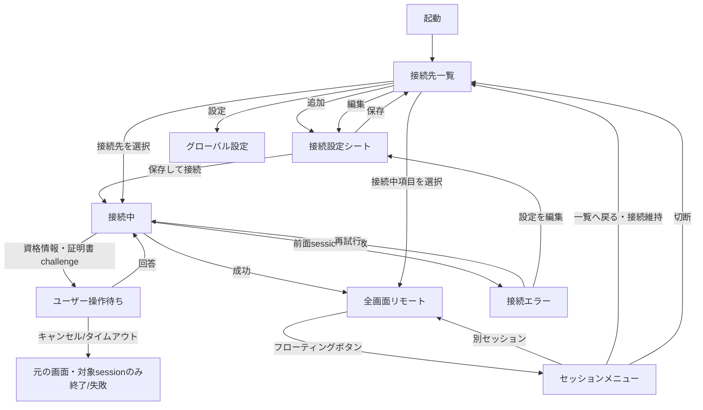

# UI・画面遷移設計

## 1. UX 原則

- 接続中はリモート画面を最大化し、操作 UI は必要なときだけ重ねる。
- 「一覧へ戻る（接続維持）」と「切断」を別の操作・文言・アイコンにする。
- キーボード/マウス入力先は常に一つにし、現在のセッション名を確認できるようにする。
- エラーは FreeRDP の番号ではなく、ユーザーが次に取れる操作とともに示す。
- iPad はフォーム sheet/popover、iPhone は large/full-height sheet に自動適応する。
- RDP 固有項目をセクション化し、将来 SSH を追加しても一覧と基本遷移を変えない。

## 2. 画面遷移



接続中 overlay、認証入力、証明書確認は独立した navigation destination ではなく、接続処理に紐づく modal state とする。証明書は TLS 接続中に提示されるため、接続前の画面として扱わない。

複数 session が同時に challenge 待ちになる場合、SessionManager は `[SessionID: SessionChallenge]` を保持し、focused/ユーザーが開始した session、次に受信時刻の古いものを一つずつ modal 表示する。他 session は一覧/スイッチャーに「操作待ち」を表示する。challenge ID と connection generation で二重回答と再接続後の stale 回答を拒否する。キャンセル/タイムアウトは modal を閉じて表示前の画面へ戻り、対象 session だけを終了/失敗にする。非 focused session の失敗は現在画面を遷移させず badge/toast で通知する。

## 3. 接続先一覧

```text
┌──────────────────────────────────────────────┐
│ mRemote                         [設定] [＋]   │
├──────────────────────────────────────────────┤
│ 実行中 (2)                                   │
│ ● Office PC       接続済み       RDP   [›]   │
│ ◌ Lab Server      再接続中…      RDP   [›]   │
├──────────────────────────────────────────────┤
│ 接続先                                       │
│   Home PC         home.example:3389   RDP     │
│   Test VM         192.0.2.10          RDP     │
└──────────────────────────────────────────────┘
```

各行に表示するもの:

- 表示名、ホスト（マスク設定時は表示名のみ）、protocol badge
- 実行中の場合は接続状態と activity/error indicator
- 必要に応じて最終接続日時

操作:

| 操作 | 結果 |
|---|---|
| 未接続行を tap | 新しい SessionID で接続し、接続中 overlay を表示 |
| 接続済み行を tap | 既存 session へ復帰 |
| swipe/context menu | 編集、複製、新しいセッションで接続、切断、削除 |
| ＋ | 空の接続設定 sheet |
| 設定 | グローバル設定 |

削除対象 profile に接続中 session がある場合、「接続先だけ削除」と「切断して削除」を明確に選ばせる。既定は破壊の少ない前者とし、実行中 session は終了まで snapshot 設定を保持する。

空状態では機能説明と「最初の接続先を追加」を表示する。LAN 許可がまだなら、実際に LAN 宛てへ接続する直前に用途を説明して OS prompt を出す。

新しい session の推定 framebuffer/codec budget が端末別上限を超える場合は接続前に理由を表示し、既存 session の切断または低い解像度を提案する。既存 session を自動切断しない。

## 4. 接続設定シート

iPad は中央の form sheet、iPhone は large sheet とする。必須値を満たすまで「保存して接続」は無効。編集中の変更を破棄するときだけ確認を出す。

### 4.1 項目

| セクション | 項目 | 既定/検証 |
|---|---|---|
| 基本 | 表示名 | 空ならホスト名から補完 |
| 基本 | プロトコル | RDP。将来 SSH を追加 |
| 基本 | ホスト | DNS 名、IPv4、IPv6。scheme を含めない |
| 基本 | ポート | `3389`、1...65535 |
| 認証 | ユーザー名 | 任意。UPN 形式も許可 |
| 認証 | ドメイン | 任意。UPN と重複時は説明 |
| 認証 | パスワード | 表示切替あり。profile 本体へ保存しない |
| 認証 | 資格情報 | 毎回入力 / Keychain に保存 |
| 表示 | 解像度 | グローバルを使用 / 表示領域に合わせる / 固定 |
| 表示 | 固定サイズ | 幅×高さ。固定選択時のみ |
| 表示 | 表示モード | グローバルを使用 / Fit / 100% |
| 表示 | 色/品質 | グローバルを使用 / 自動 / 詳細 |
| 入力 | Windows 配列 | グローバルを使用 / 日本語 106/109 / US / 自動 |
| 入力 | スクロール方向 | グローバルを使用 / 通常 / 反転 |
| リソース | リモート音声 | グローバルを使用 / この端末で再生 / 無効 |
| リソース | クリップボード | グローバル / 無効 / 双方向 / 送信のみ / 受信のみ |
| 接続 | 自動再接続 | グローバルを使用 / ON / OFF |
| セキュリティ | NLA/TLS | 安全な自動判定を既定。legacy は詳細設定で警告 |
| 証明書 | 信頼状態 | 未確認/信頼済み fingerprint の表示と解除 |

カメラ、マイク、drive、printer、smartcard は項目自体を表示しない。RD Gateway/RemoteApp は MVP 外のため schema extension point だけを残す。

英数/かな→無変換/変換は日本語 106/109 profile でのみ保証する。US/自動を選ぶときは、この mapping が保証外になることを項目直下へ表示する。

### 4.2 保存と上書き

グローバル既定値を持つ項目は `グローバルを使用` / explicit value の二状態にする。単に現在値をコピーすると、後でグローバル設定を変更しても profile に反映されないためである。

シート下部の action:

- 新規: `キャンセル`、`保存`、`保存して接続`
- 編集: `キャンセル`、`保存`
- 実行中 profile の編集: handshake/channel/profile 項目は次回接続から有効。現在だけ変える zoom/scroll/mute は profile sheet ではなく session runtime 設定で扱う

## 5. 接続・認証・証明書 UI

接続中 overlay は `ホストを検索中`、`安全な接続を確立中`、`認証中`、`デスクトップを準備中` を段階表示し、常にキャンセル可能にする。

パスワードが未保存/失効したときは session に紐づく資格情報 sheet を出す。証明書 challenge は次を表示する。

- 接続先ホスト/ポート
- 問題の種類（自己署名、期限切れ、名前不一致、発行元不明、fingerprint 変更）
- subject/issuer、有効期間、SHA-256 fingerprint
- 有効期間/hostname が正常で private CA/自己署名だけが問題の場合: `キャンセル`、`今回のみ信頼`、`この接続先で信頼`
- 期限切れ/hostname mismatch の場合: `キャンセル` のみ。fingerprint 変更時は旧信頼を設定画面で明示削除してから再確認
- 接続先が IP literal で name binding が成立しない場合: `キャンセル`、`今回のみ信頼`、`この接続先で信頼` を出しつつ、「hostname は検証されていない。fingerprint だけがこのサーバーの識別根拠」である旨を必ず併記する

fingerprint が以前の保存値から変化した場合は強い警告にし、通常の初回自己署名と同じ見た目で承認させない。

エラー画面には `再試行`、`接続設定を編集`、`診断情報をコピー`、`閉じる` を、エラー分類に応じて表示する。診断コピーは秘密値を除く。

## 6. 全画面リモート画面

```text
┌──────────────────────────────────────────────┐
│                                              │
│              Remote desktop                  │
│                                              │
│                                      [ ◉ ]   │ ← 移動・端吸着可能
└──────────────────────────────────────────────┘
```

- desktop は既定で safe area の内側に描画し、Dynamic Island / notch、画面の角、ホームインジケータを避ける（外側は黒）。インセットは UIKit のウィンドウから端末・向きごとに取得し、要求する解像度もその内側の大きさになる。デッキ表示中は下端がデッキ側なので上・左右だけを避ける。「画面の端まで使う」（セッションメニューの「表示」と設定の「表示」、端末に保存し全セッション共通）をオンにすると従来どおり画面全体に描画する。
- 初期表示は Fit。pinch で zoom、zoom 後は pan。1 本指 double tap はリモートの double click へ送り、Fit/100% はメニューまたは 2 本指 gesture に分離する。
- 接続名/状態は接続直後と切替直後に短い toast で示す。
- network degraded、再接続中、入力 focus 喪失は非妨害的な status chip で示す。
- remote content を app switcher snapshot に残さないよう scene inactive 時に privacy cover を重ねる。

### 6.1 フローティングボタン

- safe area 内の端へ吸着し、drag で移動可能。
- 44×44 pt 以上の hit area と VoiceOver label を持つ。
- 数秒後に半透明化し、pointer hover/touch で復帰する。
- 位置は device orientation/size class ごとに保存し、画面外へ出た場合は clamp する。
- その上にキーボードボタンを並べ、二つは一緒に動く（Windows App と同じ）。iOS のキーボードか手元キーボードが出ていればそれを隠し、どちらも出ていなければ「キーボードボタン」（セッションメニュー、既定 `iOS のキーボード`、端末に保存）で選んだ方を出す。iOS のキーボードが出ている間は二つともキーボードの上へ逃げる。

tap すると compact menu または bottom sheet を表示する。

```text
Office PC                 ● 接続済み
──────────────────────────────────
セッションを切り替える        [3 ›]
キーボード / 拡張キー
表示: Fit                     [›]
入力・スクロール              [›]
クリップボード                [›]
現在のセッション設定          [›]
接続設定を編集（次回接続）    [›]
グローバル設定                [›]
接続先一覧へ戻る（接続を維持）
再接続
このセッションを切断
```

メニューを開く前に押下中入力を解放する。閉じたら remote surface へ first responder を戻す。切断は確認後に実行するが、「一覧へ戻る」は確認も切断もしない。

`現在のセッション設定` は zoom/Fit、scroll inversion/sensitivity、local mute など `SessionRuntimeState` だけを即時変更する。`接続設定を編集` は profile を保存し、「再接続して反映」または「次回接続で反映」を選べる。`グローバル設定` は新規/継承 profile の次回接続に反映し、現在の session を暗黙に変更しない。

### 6.2 クリップボード操作

クリップボード submenu は許可方向と focused session に応じて次を表示する。

| 操作/状態 | 動作 |
|---|---|
| `端末からリモートへ貼り付け` | 明示 tap 後に pasteboard を読み、remote format-list の応答を待って対象 window へ貼り付け chord を送る |
| `端末へコピー` | remote の text offer があるとき data を要求し、検証後に pasteboard へ書く |
| `リモートのテキストがあります` | pending offer の有無、概算サイズ、発生 session を表示 |
| paste 許可拒否 | 内容を取得せず、設定変更方法と再試行を表示 |
| 完了/失敗 | session 名を含む短い toast。本文は表示/log しない |

pending offer/snapshot は session と connection generation ごとに保持する。別 session へ切り替えた間は非表示にし、元へ戻れば再利用できるが、切断/再接続時に破棄する。`双方向` は許可方向であり自動同期を意味しない。貼り付け chord の自動送信はこの明示 action のときだけ行う。

## 7. セッションスイッチャー

フローティングメニュー内の sheet に、すべての実行中 session を表示する。

| 表示 | 内容 |
|---|---|
| 主情報 | 接続名、protocol、thumbnail（設定で無効化可能） |
| 状態 | 接続済み、接続中、再接続中、ユーザー操作待ち、切断済み、エラー |
| channel | 音声/クリップボードの簡易状態 |
| 操作 | 選択、個別切断、エラー詳細 |

選択時の順序:

1. 旧 session の local 入力状態を clear し、writable なら up events を queue へ best effort で入れる。
2. 旧 session の音声を mute する。
3. focused session を更新し、新 session の最終 frame を表示する。
4. 新 surface を first responder にして入力 gate を開く。
5. 短い接続名 toast を表示する。

非選択 session は接続を維持し、presentation と音声だけを縮退する。各 session の zoom/pan/scroll position は別々に保持する。

切断済み/エラー session は結果と `再接続` を確認できるまで一覧に残し、ユーザーが閉じた時に実行中 section から除く。同一 profile の既存 session を選ぶ通常 tap はその session へ戻り、明示的な `新しいセッションで接続` だけが多重接続を作る。

## 8. グローバル設定

| カテゴリ | 設定 |
|---|---|
| 入力 | スクロール方向、感度、Cmd の割当、入力診断。scroll は「ホイールを上へ動かした結果」の図/preview を表示 |
| ソフトキーボード | ローカル/ホスト IME の既定、拡張キーバー配置（後半） |
| 表示 | Fit/100% の既定、動的解像度、品質/フレーム上限 |
| セッション | 自動再接続、画面スリープ防止。前景で一覧へ戻るだけでは常に接続維持 |
| 音声 | 再生既定。非 focused session は常に mute |
| クリップボード | 無効/双方向/送信のみ/受信のみ、手動同期 |
| セキュリティ | 保存済み資格情報、信頼済み証明書の管理 |
| 外観 | テーマ、フローティングボタン位置/透明度 |
| 診断 | app/FreeRDP version、redacted log export、license |

未実装の後続機能は無効な設定として先出しせず、該当 phase で追加する。変更が `現在のセッション`、`次回接続`、`アプリ再起動後` のどれで反映されるかを各項目に表示する。

## 9. ソフトウェアキーボード UI（後半）

セッションメニューの keyboard action で system keyboard と拡張キーバーを表示する。現在のモードを `手元IME` / `ホストIME` の segmented control とラベルで常時識別できるようにする。

```text
┌ Esc  Tab  Ctrl  Alt  Shift  Win  無変換  変換  Del ┐
│              system software keyboard              │
└─────────────────────────────────────────────────────┘
             [手元IME | ホストIME]
```

- Ctrl/Alt/Shift/Win は one-shot と lock を色/形だけに頼らず表示する。
- ホスト IME モードでは変換/無変換を常時表示する。
- 手元 IME モードでは未確定文字を remote desktop と混同しない composition bar に表示する。
- 拡張キーバーは両モードで表示する。手元 IME の marked text 中は `確定`/`キャンセル` を先に選ぶまで remote modifier/chord を送らない。
- モード切替時に marked text があれば確定/キャンセルを選ぶ。
- keyboard を閉じたら仮想修飾キーをすべて解放し、物理 input surface に focus を返す。

### 9.1 折りたたみ端末のラップトップ姿勢

iPhone Duo のように画面の長辺を横切って中央で折れる端末で、ヒンジが半開き (`UIHingeInteraction` の `partiallyOpen`) かつ縦長のとき、画面を上下に分ける。iOS 27.1 はヒンジの状態と角度しか教えないため、分割位置は画面中央とする。

```text
┌──────────────────────┐
│    リモート画面        │  立っている側
├──────── hinge ───────┤
│ Esc F1 … F12 Del      │
│ 半/全 1 2 … ¥ ⌫       │  手元側
│ …  PC 配列キーボード    │
│   ┌──トラックパッド──┐ │
│   └────────────────┘ │
│   [ 左 ]   [ 右 ]     │
└──────────────────────┘
```

- キーボードは接続先のキーボードプロファイル (JIS / US) の配列で、各キーは HID usage として送る。文字ではなくキー位置なので、変換はホスト IME が行う。
- キーは指が触れている間だけ host で押下状態になり、Backspace や矢印はリピートする。修飾キーは押しながら他のキーで同時押し、単独タップで one-shot → lock → off。
- Windows 配列の Win キーだけは単独タップで Win そのものを送る（スタートメニュー）。0.5 秒以上の長押しで one-shot になり、ラッチ中のタップは lock → off と進む。Mac の ⌘ は他の修飾キーと同じ。
- トラックパッドは相対移動 (速いほど加速)。1 本指タップで左クリック、2 本指タップで右クリック、2 本指ドラッグでスクロール。下の左右ボタンを押したまま動かすとドラッグ。
- ヒンジ位置の変化、メニュー表示、フォーカス喪失でデッキが押しているキーとボタンはすべて解放する。
- 手元キーボード（デッキ）は折りたたみでない端末でも使える。セッションメニューの「手元キーボード（PC 配列）を表示」/「手元キーボードを隠す」で出し入れし、「手元キーボード」で `折りたたみ端末を折り曲げたとき`（既定）/ `常に表示` / `表示しない` を選べる。端末に保存し、全セッション共通。ヒンジの無い端末では既定のままだと出ないので、表示ボタンか `常に表示` を使う。
- 「Caps キー」で A の左のキーを `Caps Lock`（既定）か `Ctrl` にできる。端末に保存し、全セッション共通。JIS でもこのキーは Caps Lock の usage を送るので表示は Caps（無シフトで日本語 IME の英数切替になるのは Windows 側の動作）。Mac 配列は `CapsLockRole` の全項目（option / command / escape / 何もしない）に対応するが、まだ選べない。
- 「手元側の配置」で `キーボード / トラックパッド`（既定）/ `トラックパッド / キーボード` / `キーボードのみ` を選べる。端末に保存し、全セッション共通。左右ボタンはどちらの配置でもパッドの手前側に置く。
- `キーボードのみ` では手元側の全体をキーボードにし、上側のリモート画面をトラックパッドとして使う（相対移動、タップで左、2 本指タップで右、2 本指スクロール）。1 本指のパンとダブルタップによる表示操作は無効にし、ピンチでの拡大は残す。
- 「トラックパッドのクリックボタン」をオフにすると左右ボタンを消してパッドをその分広げる。クリックはタップ（左）と 2 本指タップ（右）、ドラッグは長押しから。端末に保存し、全セッション共通。
- ボタンの無い面でもドラッグできるよう、トラックパッドとして使う面ではどれも、指を止めて長押し（0.45 秒）してから動かすと左ボタンを押したままの移動になる。
- 「表示」の「Windows の拡大率」で Windows 側の拡大率を選ぶ（自動＝端末の画面倍率、または 100〜300%）。接続時と各解像度変更で送り、変えるとその場で反映する。
- 「表示」の「解像度」で、`自動（画面に合わせる）` か固定サイズ（1024×768〜3840×2160 の 4:3 / 5:4 / 16:9 / 16:10）を選ぶ。そのセッションだけの変更で、DISP 対応サーバーならその場で反映する。固定サイズは回転やデッキ表示でも変えず、画面には縮小して収める。非対応サーバーではその旨を表示し、接続先の設定（「画面 > 解像度」、既定は全体設定に従う）か設定の「表示 > 解像度」で指定すると次の接続から使われる。
- 「手元キーボード表示中の解像度」で、デッキ表示時にデスクトップ部分の大きさへ解像度を変える（既定）か、画面全体の解像度のまま縮小表示するか、`表示中の大きさで固定` するかを選ぶ。縮小表示は折り曲げても Windows のウィンドウ配置が崩れない。固定はデッキを隠しても表示中と同じ解像度（同じ縦横比）を要求し続け、デッキの無い画面には拡大して表示する。
- デッキの位置: 折りたたみ端末を折り曲げているときはヒンジの下に固定。それ以外では「手元キーボードの位置」で `画面の下`（既定）か `フローティング`（iPad と折りたたみ端末のみ）を選ぶ。端末に保存し、全セッション共通。
  - `画面の下`: デッキ上端のつまみを上下にドラッグして高さを画面の 25〜75% で変えられる（縦横別に保存）。つまみのダブルタップで元の高さ（50%、左右分割は 30%）に戻る。メニューの「手元キーボードの大きさを元に戻す」は縦・横・分割の高さとフローティングの位置・大きさをまとめて戻す。デスクトップ部分は残りの高さになり、解像度もそれに合わせて変わる（固定や縮小表示の設定に従う）。
  - `フローティング`: デスクトップは画面全体のままで、デッキはその上のパネルになる。上のバーで移動、バー右端のつまみで大きさを変える（左下の角を固定）。最小 320×180pt、画面からはみ出さない。位置と大きさは画面に対する割合で保存し、回転しても同じあたりに置く。
- 「横向きでは左右に分ける」（iPad と折りたたみ端末、既定オフ）: 横向きで画面の下に置いたデッキを、左手側（F1〜F6、1〜5、Q〜T、A〜G、Z〜B）と右手側（F7〜、6〜、Y〜、H〜、N〜）に分けて左右の端に寄せ、トラックパッドを間に置く。スペースは両側にある。キーは親指が届くよう下端に揃え、高さは分割時だけ別に保存する（既定 30%）。フローティングでは分けない。
- 「横向きで折り曲げたときも手元キーボードを出す」（折りたたみ端末のみ、既定オフ、手元キーボードが `折りたたみ端末を折り曲げたとき` のときだけ有効）: オフでは縦向き（ラップトップの形）で折ったときだけデッキを出す。オンでは本のように横向きで少し折ったときも画面の下に出す（左右分割の設定に従う）。画面の向きはシステムに任せる: Duo はウインドウの大きさを変えられる端末で、アプリから向きを変える要求（`requestGeometryUpdate`）は「現在のウインドウモードでは許可されていない」と断られるため、折ったときに縦向きへ固定することはできない。
- Xcode 27.1 より前の SDK でビルドするとヒンジは常に「なし」となり、`常に表示` でのみ使える。

## 10. アクセシビリティと誤操作防止

- 接続・設定画面は Dynamic Type、VoiceOver、Switch Control に対応する。
- remote framebuffer 自体の内容解析は行わないが、floating controls には完全な accessibility label/hint を付ける。
- 切断、profile 削除、保存済み資格情報削除は対象名を含む確認を出す。
- pointer だけでなく touch で全ローカル UI を操作できる。
- 色だけで接続状態や modifier lock を表さない。
